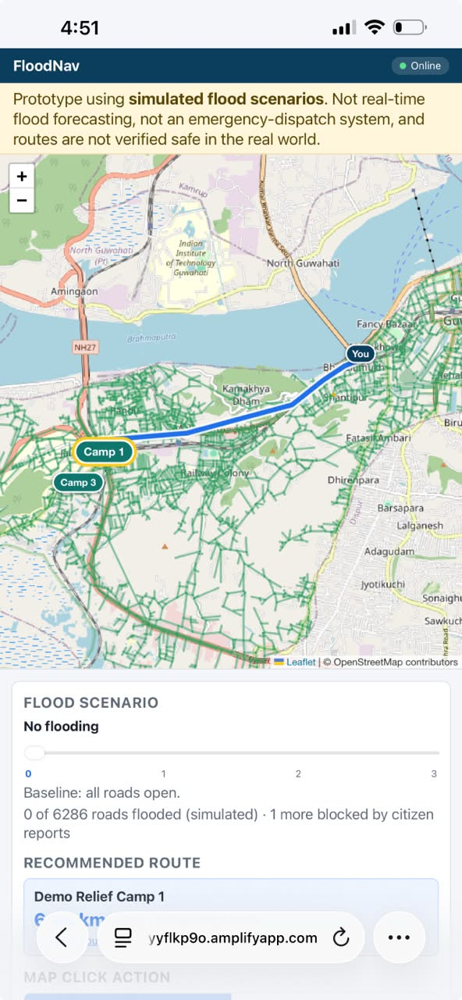
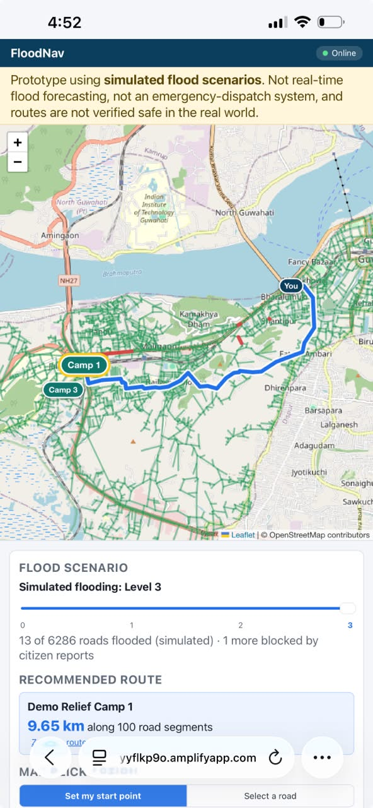
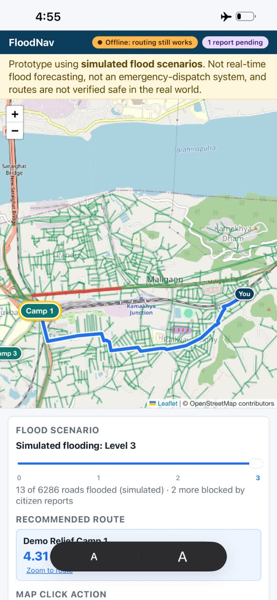
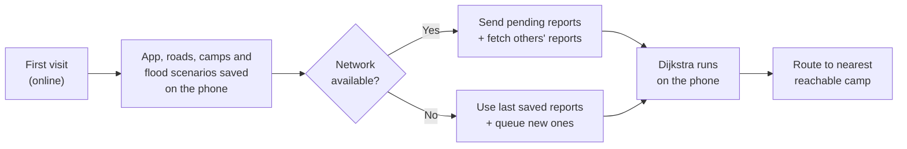
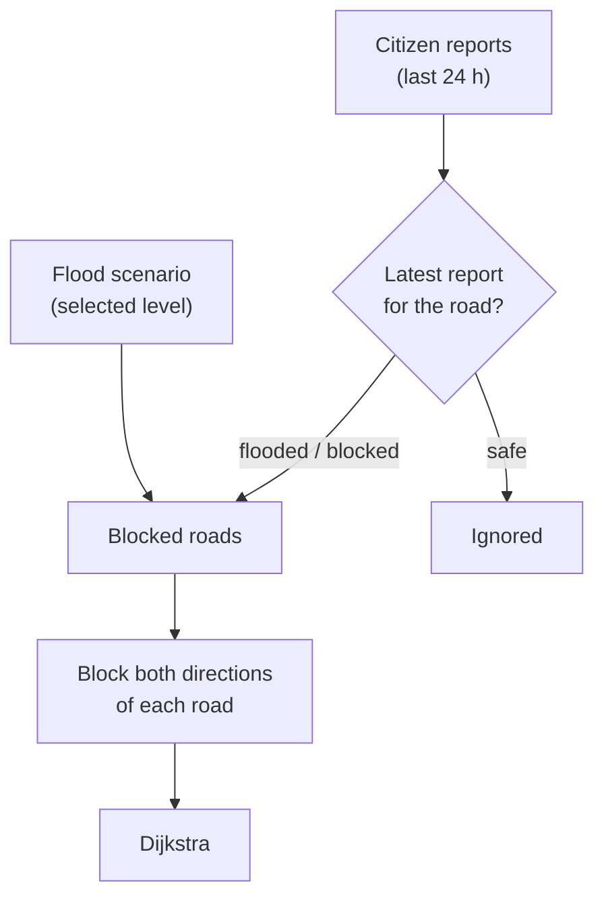
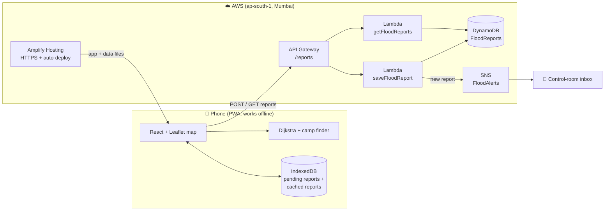
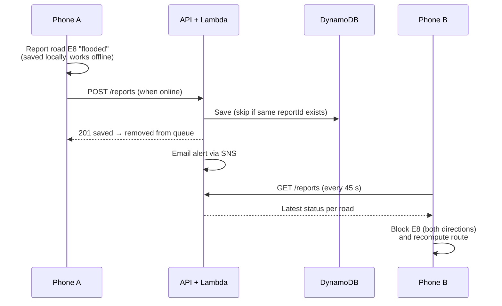

# FloodNav

**Offline-first flood evacuation routing for Guwahati.**
FloodNav finds the shortest safe route to the nearest relief camp, avoids roads that are flooded, and keeps working when the mobile network goes down.

🔗 **Live demo:** `https://main.de3qwyyflkp9o.amplifyapp.com/` &nbsp;·&nbsp; Built for the *Heat & Water* hackathon (sub-theme: Floods)

> ⚠️ **Prototype.** Flood levels are **simulated**, citizen reports are **not verified**, and routes are **not guaranteed safe** in the real world. Do not use for real emergencies.

<p align="center">
  
  
  
</p>

---

## The problem

Low-lying areas of Guwahati such as **Anil Nagar, Nabin Nagar and Rajgarh** flood almost every monsoon. When it happens, power is cut and mobile networks become unreliable, so people need help finding a way out exactly when online tools stop working.

## What it does

| Feature | How |
|---|---|
| 🗺️ **Safe route to the nearest camp** | Dijkstra's algorithm on the real road network (OpenStreetMap), skipping blocked roads |
| 🌊 **Flood-level slider** | 3 simulated flood levels; roads turn red as they go under water and the route updates instantly |
| 📴 **Works offline** | Installable web app (PWA). Map data, roads and routing all run on the phone |
| 📣 **Citizen reports** | Anyone can mark a road as *flooded*, *blocked* or *safe*. Reports made offline are saved and sent later |
| 🔁 **Shared reports** | Roads reported by others are shown on every phone and the route avoids them |
| 📧 **Control-room alerts** | Every new report emails a "control room" inbox |

---

## How it works

The key idea: **do the heavy work before the flood, while the network still works.**



### Which roads are blocked?

A road is avoided if **either** the flood scenario **or** a citizen report blocks it.



- **Citizens can only add blocks, never remove them.** A "safe" report cannot reopen a road the flood scenario has closed. A false "flooded" report only makes a route longer; a false "safe" report could send someone into water.
- Two-way roads are stored as two one-direction edges, so blocking a road blocks **both** directions.

---

## Architecture



**Why this split?** Routing happens **on the phone**, so it is instant and works offline. AWS only stores and shares reports, and it is serverless, so it costs almost nothing when idle.

### Life of a report



Each report gets an ID **on the phone** when it is created. If it is sent twice (for example, after reconnecting), the server recognises the ID and does not save a duplicate.

---

## Repository structure

```
FloodNav/
├── src/algorithms/          # Routing logic (no React/AWS, fully tested)
│   ├── dijkstra.js          #   shortest path with a min-heap
│   ├── reliefCamps.js       #   nearest reachable camp
│   └── blockedRoads.js      #   merge scenario + citizen blocks
├── tests/                   # node:test unit + real-data tests
├── backend/                 # AWS Lambda functions (Python)
│   ├── save_report/         #   POST /reports → DynamoDB + SNS alert
│   └── get_reports/         #   GET /reports  → recent reports per road
└── frontend/                # React + Vite PWA
    ├── public/data/         #   roads.json, camps.json, scenarios.json
    ├── src/components/      #   Map, controls, report form, status bar
    ├── src/lib/             #   data loading, routing adapter, API, IndexedDB
    └── vite.config.js       #   PWA + offline caching
```

---

## Run locally

**Requirements:** Node.js 20+

```bash
# Routing tests (from the repo root)
npm test

# Frontend
cd frontend
npm install
npm run dev          # http://localhost:5173
```

To connect the report API, create `frontend/.env`:

```
VITE_REPORTS_ENDPOINT=https://<api-id>.execute-api.ap-south-1.amazonaws.com/reports
```

Without it the app still works: routing runs normally and reports stay saved on the device.

**Testing offline mode:** offline support only works in a production build.

```bash
npm run build && npm run preview
```

Then in Chrome DevTools → **Network** → set to **Offline** and reload. On a phone, use airplane mode.

---

## Data

All map data lives in `frontend/public/data/` and is generated from OpenStreetMap for the Anil Nagar / Nabin Nagar area.

| File | Contents |
|---|---|
| `roads.json` | ~5,100 junctions (`nodes`) and ~12,000 road segments (`edges`: `id`, `from`, `to`, `distance` in metres, `oneway`) |
| `camps.json` | Relief camps: `id`, `name`, `lat`, `lng` (snapped to the nearest junction) |
| `scenarios.json` | 3 simulated flood levels, each with the road IDs it blocks |

Check the scenarios against the road data with `node check-scenarios.mjs` (from `frontend/`).

---

## Report API

Base URL: `https://<api-id>.execute-api.ap-south-1.amazonaws.com/reports`

### `POST /reports`: submit a report

```json
{
  "reportId": "rpt-1728540000000-a7f3",
  "roadId": "E8",
  "type": "flooded",
  "description": "Water up to knee level",
  "createdAt": "2026-10-10T09:15:00Z"
}
```

| Field | Rules |
|---|---|
| `reportId` | Required. Made on the phone, never changes. Letters, numbers, `-`, `_` (max 64) |
| `roadId` | Required. An edge `id` from `roads.json` |
| `type` | Required. `flooded`, `blocked` or `safe` |
| `description` | Optional, max 300 characters |
| `createdAt` | Optional, ISO time |

| Reply | Meaning | App action |
|---|---|---|
| `201` | Saved | Remove from queue |
| `200` + `"duplicate": true` | Already saved | Remove from queue |
| `400` | Invalid data | Drop (retrying won't help) |
| `429`, `5xx`, no network | Temporary problem | Keep and retry later |

### `GET /reports?hours=24`: recent reports

Returns the latest status of each reported road (default last 24 h, max 168 h):

```json
{
  "ok": true,
  "count": 3,
  "roads": {
    "E8": { "latestType": "flooded", "lastReportedAt": "2026-10-11T10:12:17+00:00", "reportCount": 2 }
  },
  "reports": [ "...newest first..." ]
}
```

---

## AWS setup (summary)

All resources are in **ap-south-1 (Mumbai)**.

| Service | Name | Notes |
|---|---|---|
| DynamoDB | `FloodReports` | Partition key `reportId` (String), on-demand capacity |
| Lambda | `saveFloodReport` | Env: `TABLE_NAME`, `TOPIC_ARN`, `APP_URL`. Permissions: `dynamodb:PutItem`, `sns:Publish` only |
| Lambda | `getFloodReports` | Env: `TABLE_NAME`. Permission: `dynamodb:Scan` only |
| API Gateway (HTTP API) | `FloodReportsAPI` | `POST` and `GET /reports`, CORS limited to the app's URL, throttled (POST 5/s, GET 20/s) |
| SNS | `FloodAlerts` | Email subscription for the control-room inbox |
| Amplify Hosting | — | Deploys `frontend/` from `main` with HTTPS. Env: `VITE_REPORTS_ENDPOINT` |

Each Lambda only has the one permission it needs. Removing `TOPIC_ARN` turns email alerts off without affecting reports.

---

## Limitations

- **Simulated floods.** Flood levels are hand-built scenarios, not a live forecast.
- **Unverified reports.** One person can block a road; there is no trust system yet.
- **First visit needs internet.** The app must be opened once online to save data and map tiles. Map areas never viewed show blank tiles offline (roads and routes still draw).
- **iPhone limits.** Safari may clear saved data after long inactivity, and background sync only works on Android/Chrome.

## Future scope

- Live rainfall forecasts (IMD) and elevation data to predict flooding automatically
- Trust rules: block a road only after several reports or a verified volunteer
- Phone-to-phone sharing over Bluetooth when there is no network at all
- SMS alerts and push notifications
- Road names in reports and alerts

---

## Team

| Role | Member |
|---|---|
| Map & road data | `Anisha` |
| Routing algorithms | `Shreya Tripathi` |
| Frontend & offline app | `Siddhi Bansal` |
| AWS backend & integration | `Niteshika Jain` |
